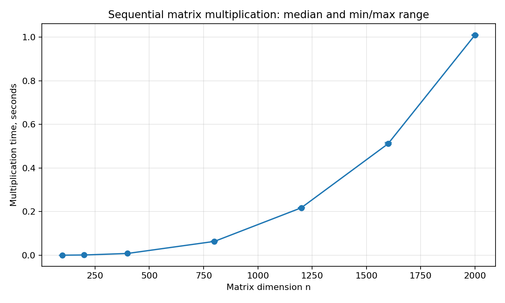

# Лабораторная работа №1

## Задание

Реализовать последовательное умножение двух квадратных матриц на C++. Прочитать исходные матрицы из файлов, записать результат в файл, определить время вычислений и объём задачи. Автоматически проверить результат сторонней библиотекой и исследовать зависимость времени от размера матриц.

[Задания курса](https://docs.google.com/document/d/1xfbPhD-x879jaVGjsjyDI_hHE0IXJW1dD5MqzyosBEk/edit). Срок сдачи первой работы — 05.10.2026.

## Решение

[Исходный код — main.cpp](main.cpp).

Элемент произведения вычисляется по формуле `C[i][j] = sum(A[i][k] * B[k][j], k = 0..n-1)`. Матрицы хранятся в одномерных `std::vector<double>` по строкам. Индекс элемента — `i * n + j`.

В реализации используется порядок циклов `i → k → j`: для каждой строки A берётся элемент A[i][k] и умножается на всю строку B[k]. Это позволяет последовательно обращаться к элементам B и C. Результат обнуляется перед началом умножения. Программа выполняется в одном потоке.

Сложность по времени — `O(n³)`, по памяти — `O(n²)`. Выполняются `n³` умножений и `n³` сложений, включая прибавление первого произведения к нулю. Объём числовых данных трёх матриц — `3 * n² * sizeof(double) = 24 * n²` байт. Это объём самих элементов; служебная память и резервная ёмкость контейнеров в него не входят.

Время измеряется через `std::chrono::steady_clock` только вокруг циклов умножения. Чтение файлов, выделение и обнуление результата, проверка чисел и запись файла в замер не входят.

## Формат файлов

Первая строка содержит положительное целое число `n`, затем записываются `n` строк по `n` элементов. Разделитель — пробел, десятичный разделитель — точка. Для A, B и C используется один формат.

Пример A:

```text
2
1 2
3 4
```

Пример B:

```text
2
5 6
7 8
```

Результат C:

```text
2
19 22
43 50
```

Готовые входные файлы находятся в [data](data), контрольный ответ — [C_expected.txt](data/C_expected.txt). Программа проверяет размеры, число элементов, корректность и конечность чисел, доступность файлов. При ошибке выводит сообщение и возвращает ненулевой код завершения. Результат сохраняется с 17 значащими цифрами, чтобы не терять точность `double` при записи.

## Сборка и запуск

Нужны компилятор C++17, Python 3.10+ и библиотеки из [requirements.txt](requirements.txt).

Из корня репозитория:

```bash
cd Lab1
python3 -m venv .venv
source .venv/bin/activate
python3 -m pip install -r requirements.txt
make
make example
make check
```

`make example` запускает C++ на примере 2×2 и проверяет сохранённый результат NumPy. `make check` выполняет автоматические проверки правильных и ошибочных входных данных.

Без Makefile:

```bash
c++ -O2 -std=c++17 -Wall -Wextra -Wpedantic main.cpp -o lab1
./lab1 data/A.txt data/B.txt data/C.txt
python3 verify.py data/A.txt data/B.txt data/C.txt
```

На Windows для виртуального окружения используется `.venv\Scripts\activate`; собранная программа может называться `lab1.exe`.

Программа сообщает `size` — размер матриц, `time_seconds` — время умножения в секундах, `matrix_bytes` — объём данных матриц и `scalar_operations` — число арифметических операций.

Создание других входных данных:

```bash
python3 generate.py --size 400 --seed 42 --output-dir generated
./lab1 generated/A.txt generated/B.txt generated/C.txt
python3 verify.py generated/A.txt generated/B.txt generated/C.txt
```

## Автоматическая верификация

[verify.py](verify.py) читает A, B и сохранённую программой C. Эталон рассчитывается независимо через `numpy A @ B`. Проверяются размеры и конечность всех значений, затем каждый элемент сравнивается с условием:

```text
abs(C_cpp - C_numpy) <= 1e-9 + 1e-9 * abs(C_numpy)
```

При несовпадении верификатор возвращает ненулевой код. Дополнительно он сообщает максимальную абсолютную ошибку.

[check.py](check.py) проверяет матрицы 1×1, заранее известное некоммутативное произведение 2×2, нулевую и единичную матрицы, отрицательные и дробные значения, случайные матрицы нескольких размеров. Проверяются неверные размеры, недостающие и лишние элементы, нечисловые и бесконечные значения, несовпадение размеров и ошибки доступа к файлам. Отдельно проверяется, что верификатор отвергает неверный ответ, неверную форму и NaN.

Обычная сборка и сборка с UndefinedBehaviorSanitizer прошли все 31 проверки. Сборка с `-Wall -Wextra -Wpedantic` выполнена без предупреждений.

## Эксперименты

Эксперименты проведены 04.10.2026 на Apple M4, ARM64, macOS 26.6.2. Доступны 10 логических ядер, C++ программа использует один поток. Компилятор — Apple Clang 17.0.0, флаги — `-O2 -std=c++17 -Wall -Wextra -Wpedantic`. Для верификации использованы Python 3.14.3 и NumPy 2.4.3.

Размеры: 100, 200, 400, 800, 1200, 1600, 2000. Для каждого размера создана пара матриц со значениями из `[-10, 10)` с `seed=42`. Один прогревочный запуск исключён из статистики, затем выполнены пять запусков на одинаковой паре матриц. Каждый сохранённый результат, включая прогрев, проверен NumPy. В таблице приведена медиана пяти замеров; исходные значения и стандартное отклонение сохранены в CSV.

| n | Медиана, с | Минимум, с | Максимум, с | Данные A+B+C, МиБ | NumPy |
| ---: | ---: | ---: | ---: | ---: | :---: |
| 100 | 0.000093167 | 0.000092875 | 0.000093458 | 0.229 | Да |
| 200 | 0.000989875 | 0.000977291 | 0.000997792 | 0.916 | Да |
| 400 | 0.008032167 | 0.008011833 | 0.008431333 | 3.662 | Да |
| 800 | 0.063358250 | 0.063232709 | 0.064426250 | 14.648 | Да |
| 1200 | 0.217428375 | 0.216641125 | 0.218193458 | 32.959 | Да |
| 1600 | 0.511383625 | 0.510259625 | 0.516574000 | 58.594 | Да |
| 2000 | 1.010050459 | 1.007481708 | 1.012208375 | 91.553 | Да |



Во всех 35 измеряемых и семи прогревочных запусках проверка пройдена. Максимальная абсолютная ошибка в этой среде равна нулю. На другой платформе порядок вычислений и округление могут отличаться, поэтому верификатор использует указанный допуск.

Файлы результатов:

- [raw.csv](results/raw.csv) — все отдельные замеры и результаты верификации.
- [summary.csv](results/summary.csv) — медиана, минимум, максимум и стандартное отклонение.
- [environment.json](results/environment.json) — параметры запуска, среда и контрольная сумма бинарника.
- [timing.svg](results/timing.svg) и [timing.png](results/timing.png) — график с диапазоном минимум–максимум.

Воспроизведение серии:

```bash
make experiments
```

Или с указанием параметров:

```bash
python3 run_experiments.py --binary ./lab1 --sizes 100 200 400 800 1200 1600 2000 --repeats 5 --seed 42 --compiler c++ --flags="-O2 -std=c++17 -Wall -Wextra -Wpedantic" --output-dir results
```

Большие матрицы создаются во временном каталоге; после экспериментов остаются результаты замеров. Генератор и seed позволяют повторить создание входных файлов. Повторный запуск обновляет содержимое каталога `results`.

## Выводы

Последовательная программа корректно умножает квадратные матрицы из файлов и сохраняет результат. Правильность подтверждена известными примерами и независимой автоматической проверкой NumPy.

Время растёт приблизительно как `n³`. При переходе от 400×400 к 800×800 медиана увеличилась примерно в 7,89 раза, от 800×800 к 1600×1600 — в 8,07 раза; теоретическое увеличение при удвоении n равно восьми. Для 2000×2000 медиана составила 1,010050459 с, объём числовых данных — 96 000 000 байт, количество операций — 16 000 000 000.

Различия между фактическими отношениями времени и точным кубическим ростом зависят от условий запуска и особенностей выполнения на конкретном процессоре. Здесь установлена зависимость для измеренной среды; причины отдельных отклонений не исследовались профилировщиком.

Эта реализация служит последовательной базой для сравнения с параллельными версиями следующих лабораторных работ.
